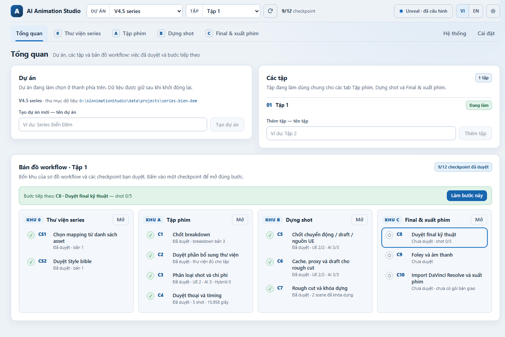
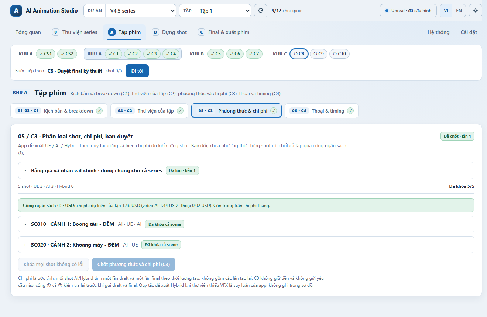
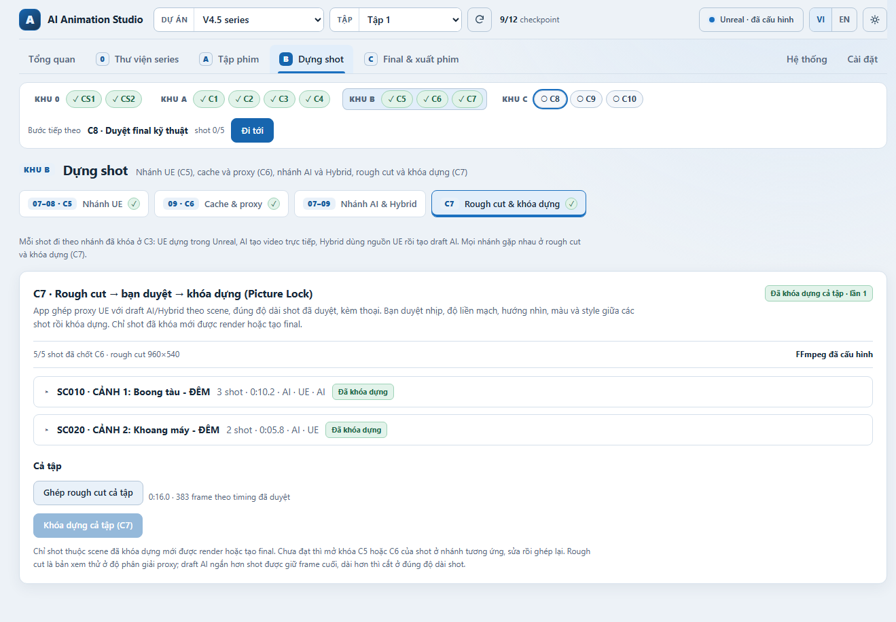
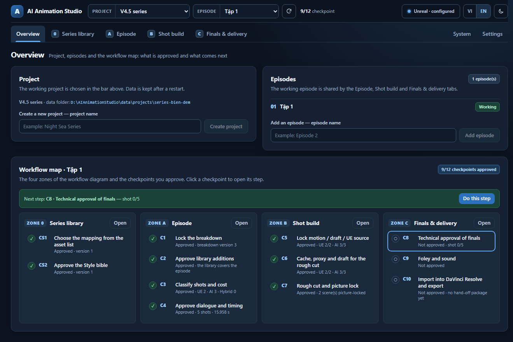

# AI Animation Studio

**Ứng dụng Windows điều phối sản xuất phim hoạt hình 3D, từ kịch bản đến gói bàn giao cho DaVinci Resolve, kết hợp Unreal Engine 5.8 với các dịch vụ AI.**



> **Trạng thái:** mã nguồn đang phát triển. Phần điều phối, giao diện, xử lý video bằng FFmpeg và phân tích kịch bản qua Claude Code đã chạy thật trên máy phát triển. Các script Unreal, kết nối OpenAI, ElevenLabs, Seedance, MiniMax, HunyuanVideo-Foley và việc import vào DaVinci Resolve chưa được chạy trên hệ thống thật. [Mục 8](#8-trạng-thái-triển-khai-thực-tế) ghi rõ từng phần.

## Mục lục

1. [Mô tả ứng dụng](#1-mô-tả-ứng-dụng)
2. [Cài đặt: clone về là chạy](#2-cài-đặt-clone-về-là-chạy)
3. [Hướng dẫn sử dụng nhanh](#3-hướng-dẫn-sử-dụng-nhanh)
4. [Hướng dẫn sử dụng chi tiết](#4-hướng-dẫn-sử-dụng-chi-tiết)
5. [Các khu vực làm việc](#5-các-khu-vực-làm-việc)
6. [AI hoạt động như thế nào?](#6-ai-hoạt-động-như-thế-nào)
7. [Phiên bản, khóa và duyệt](#7-phiên-bản-khóa-và-duyệt)
8. [Trạng thái triển khai thực tế](#8-trạng-thái-triển-khai-thực-tế)
9. [Kiến trúc](#9-kiến-trúc)
10. [Dữ liệu và bảo mật](#10-dữ-liệu-và-bảo-mật)
11. [Cấu trúc repository](#11-cấu-trúc-repository)

## 1. Mô tả ứng dụng

AI Animation Studio chạy trên máy của bạn: giao diện mở trong trình duyệt, còn máy chủ, cơ sở dữ liệu và media đều nằm trên máy đó. Ứng dụng giúp một người làm phim tổ chức việc sản xuất một series hoạt hình 3D mà không phải tự nhớ shot nào đã dựng, shot nào phải làm lại và đã tiêu bao nhiêu tiền cho AI.

Mọi việc đi theo **một workflow gồm 4 khu và 12 checkpoint**. Mỗi checkpoint là một lần bạn xem và duyệt; app ghi lại đúng phiên bản bạn đã duyệt.

| Khu | Việc làm ở khu này | Checkpoint |
|---|---|---|
| **0 · Thư viện series** | Chuẩn kỹ thuật và trần chi phí tháng; liệt kê nhân vật, bối cảnh từ kịch bản; quét asset trong project Unreal; chọn asset cho từng nhân vật, bối cảnh; Style bible | CS1, CS2 |
| **A · Tập phim** | Chia kịch bản thành scene và shot; bổ sung thư viện; chọn cách làm từng shot (UE, AI hoặc Hybrid) và xem chi phí; tạo thoại và chốt timing | C1, C2, C3, C4 |
| **B · Dựng shot** | Nhánh UE: sequence, animation, cache, proxy. Nhánh AI và Hybrid: video draft. Ghép rough cut và khóa dựng | C5, C6, C7 |
| **C · Final & xuất phim** | Final và chuẩn hóa từng shot; Foley và âm thanh; gói timeline, phụ đề và QC để import vào DaVinci Resolve | C8, C9, C10 |

### Tính năng chính

- **Bản đồ workflow và "bước tiếp theo".** Lúc nào cũng thấy checkpoint nào đã duyệt, cái nào đã đổi sau khi duyệt, và bấm một nút để tới đúng bước cần làm.
- **Ba cách làm một shot.** Dựng hoàn toàn trong Unreal (UE), tạo video trực tiếp bằng AI, hoặc Hybrid (nguồn từ Unreal, AI xử lý tiếp). App đề xuất theo quy tắc cố định; bạn quyết định và khóa.
- **Kiểm soát chi phí.** Trần chi phí tháng, sổ chi phí và ba cổng ngân sách chặn yêu cầu có phí trước khi gửi. Yêu cầu không rõ kết quả không bao giờ tự gửi lại.
- **Phiên bản và duyệt.** Sửa đầu vào sau khi đã duyệt thì checkpoint báo "đã đổi sau khi duyệt"; chỉ phần bị ảnh hưởng phải làm lại, phần còn lại giữ nguyên.
- **Phân tích kịch bản bằng AI.** Liệt kê nhân vật, bối cảnh và chia scene/shot bằng OpenAI API, bằng Claude qua Claude Code cài trên máy, hoặc bằng chế độ mô phỏng để thử luồng.
- **Thoại, video, âm thanh.** Thoại ElevenLabs với timing theo frame; video Seedance 2.5 và MiniMax H3; Foley bằng HunyuanVideo-Foley chạy trên máy; âm thanh xuất thành 5 stem.
- **Gói bàn giao.** Timeline FCPXML, EDL dự phòng, phụ đề SRT tiếng Việt và tiếng Anh, MP4 xem thử và báo cáo QC tự động.
- **Dễ vận hành.** Giao diện tiếng Việt và tiếng Anh, chế độ ban ngày và ban đêm, mọi cấu hình làm trong app; API key nằm trong Windows Credential Manager, không đi qua trang web.
- **Sao lưu và phục hồi** toàn bộ dữ liệu app, thư mục dự án và project Unreal.







### Dành cho ai

- Nhà làm phim độc lập hoặc studio nhỏ muốn tổ chức nhiều cảnh theo cùng một quy trình.
- Người dùng Unreal Engine cần quản lý phiên bản, các bước duyệt và nội dung do nghệ sĩ chỉnh tay.
- Nhóm phát triển muốn xây dựng pipeline có thể theo dõi, thử lại và đối soát kết quả.

Phạm vi hiện tại là **một máy Windows, một người vận hành**. Chưa có cộng tác nhiều người và chưa có bộ cài `.exe`.

## 2. Cài đặt: clone về là chạy

### Cần có trên máy

| Cần có | Ghi chú |
|---|---|
| Windows 10 hoặc 11 | Máy phát triển dùng Windows 11. |
| Python 3.14 | Nếu thiếu, file khởi chạy hỏi có cài bằng winget không. |
| Node.js 24 (LTS) | Dùng để dựng giao diện ở lần chạy đầu và sau mỗi lần cập nhật. Nếu thiếu, file khởi chạy cũng hỏi có cài không. |
| Git | Để clone. Không có Git thì dùng **Code → Download ZIP** trên GitHub. |
| Internet ở lần chạy đầu | Để tải thư viện Python và thư viện giao diện. |

Những thứ sau **không bắt buộc để mở app**; mỗi thứ chỉ cần khi bạn làm tới bước dùng nó (xem bảng ở [mục 3](#3-hướng-dẫn-sử-dụng-nhanh)): Unreal Engine 5.8 và một project, FFmpeg có kèm ffprobe, tài khoản OpenAI, ElevenLabs, Seedance hoặc MiniMax, Claude Code, HunyuanVideo-Foley, DaVinci Resolve.

### Các bước

1. Clone repository:

   ```powershell
   git clone https://github.com/vuphan04/ai-animation-studio.git
   ```

2. Mở thư mục `ai-animation-studio` và nhấp đúp **[Start-Studio.cmd](Start-Studio.cmd)**.
3. Lần đầu, file này tự tạo môi trường Python riêng trong thư mục `.venv`, cài thư viện và dựng giao diện. Việc này mất vài phút. Nếu máy chưa có Python 3.14 hoặc Node.js, cửa sổ sẽ hỏi có cài bằng winget không: bấm **C** để cài, cài xong thì đóng cửa sổ và mở lại `Start-Studio.cmd`.
4. Khi xong, trình duyệt mở `http://127.0.0.1:8000/`. Giữ cửa sổ khởi chạy mở trong lúc dùng; đóng cửa sổ đó để dừng app.

Từ lần sau chỉ cần nhấp đúp `Start-Studio.cmd`. Dữ liệu của bạn nằm trong thư mục `data` cạnh mã nguồn; thư mục này không thuộc repository và không bị ghi đè khi cập nhật.

### Cập nhật

1. Đóng cửa sổ khởi chạy đang mở.
2. Trong thư mục app, chạy `git pull`. Nếu bạn tải bằng ZIP: tải ZIP mới và chép đè các file mã nguồn, giữ nguyên thư mục `data` và `.venv`.
3. Nhấp đúp `Start-Studio.cmd`. File này tự dựng lại giao diện và cơ sở dữ liệu tự nâng cấp.

Trong **Cài đặt → Kết nối Unreal** có dòng **Bản giao diện · Máy chủ**; hai số phải giống nhau. Nếu khác nhau, bạn đang mở một cửa sổ khởi chạy cũ: đóng nó rồi mở lại.

Từ bản 2026.10.05.2 app chỉ còn một workflow. Nếu thư mục `data` có dự án tạo từ bản cũ, ở lần mở đầu tiên app chép `data/studio.sqlite3` sang `data/archive/studio-before-029_single_workflow.sqlite3` rồi chuyển dự án đó sang workflow hiện tại. Tên dự án, các tập và thư mục media được giữ; các checkpoint bắt đầu lại từ CS1. Sau khi chép source mới đè lên thư mục app cũ, các file của workflow V1 còn sót lại (ví dụ `services/api/studio/p2.py`, `apps/web/src/PlannerPage.tsx`) không được app dùng và có thể xóa.

### Lỗi thường gặp khi khởi chạy

| Cửa sổ khởi chạy báo | Cách xử lý |
|---|---|
| `Chưa có Python 3.14 trên máy này` | Bấm **C** để cài bằng winget, hoặc cài từ python.org, rồi mở lại `Start-Studio.cmd`. |
| `Chưa có Node.js trên máy này` | Bấm **C** để cài bằng winget, hoặc cài từ nodejs.org, rồi mở lại. |
| `Không cài được thư viện backend` | Kiểm tra kết nối Internet rồi mở lại. |
| `Port 8000 is occupied by another application` | Một chương trình khác đang dùng cổng 8000; đóng chương trình đó. |
| `Ứng dụng đang chạy bản cũ` | Đóng cửa sổ khởi chạy cũ rồi mở lại. |

### Dành cho người phát triển: dựng thủ công

Bước dưới đây là lựa chọn thay thế launcher khi cần chẩn đoán hoặc phát triển:

Trong PowerShell ở thư mục repository:

```powershell
py -3.14 -m venv .venv
& '.\.venv\Scripts\python.exe' -m pip install -r services/api/requirements.lock.txt
npm ci --prefix apps/web
npm run build --prefix apps/web
```

Sau khi dựng xong:

1. Mở `tools\Create-Studio-Shortcut.cmd` để tạo shortcut ở vị trí hiện tại.
2. Nhấp đúp **Start-Studio.lnk**, **Start-Studio.cmd** ở thư mục gốc hoặc mở trực tiếp `tools\Start-Studio.cmd` khi dependency/UI đã được dựng.
3. Launcher mở ứng dụng tại `http://127.0.0.1:8000/` trong trình duyệt mặc định.
4. Giữ cửa sổ launcher mở trong lúc dùng; đóng cửa sổ đó để dừng server.

Shortcut sử dụng icon capybara trong `assets/launcher`. File `.lnk` chứa đường dẫn tuyệt đối nên được tạo trên từng máy và không được đưa lên GitHub. Khi chuyển thư mục hoặc máy, tạo lại shortcut. Không copy `.venv` từ máy khác.

Khởi chạy lại khi server Studio cùng phiên bản đang chạy sẽ mở phiên đang có. Nếu server là bản cũ, launcher yêu cầu đóng cửa sổ cũ và mở lại; nếu cổng 8000 thuộc ứng dụng khác, launcher báo xung đột. Khi sửa Python cần khởi động lại backend. Khi sửa frontend, launcher tự build lại ở lần mở tiếp theo.

## 3. Hướng dẫn sử dụng nhanh

Bạn có thể mở app và thử các bước đầu ngay, chưa cần Unreal hay API key nào.

1. **Tạo dự án và tập.** Ở tab **Tổng quan**, nhập tên rồi bấm **Tạo dự án**, sau đó **Thêm tập**. Dự án và tập đang làm luôn hiện ở thanh trên cùng.
2. **Đặt chuẩn và ngân sách (S1).** Vào tab **Thư viện series**, bước **S1**: lưu FPS, độ phân giải và đặt **trần chi phí tháng**. Chưa đặt trần thì app không gửi yêu cầu có phí nào.
3. **Liệt kê nhân vật và bối cảnh (S2).** Dán kịch bản, bấm **Lưu kịch bản**, rồi **Xem chi phí liệt kê**, rồi **Liệt kê nhân vật & bối cảnh** (nút này chỉ bật sau khi bạn đã xem chi phí). Mặc định app dùng chế độ mô phỏng, không tốn phí, hiểu kịch bản viết theo dạng dưới đây:

   ```text
   CẢNH 1: Boong tàu - ĐÊM
   Thuyền trưởng đứng trước bánh lái, nhìn ra biển.
   THUYỀN TRƯỞNG: Giữ vững hướng đi.
   Lan: Vâng, thưa thuyền trưởng.

   CẢNH 2: Khoang máy - ĐÊM
   LAN: Áp suất đang giảm.
   Thuyền trưởng: Tôi xuống ngay.
   ```

   Muốn AI thật đọc kịch bản thì chọn OpenAI hoặc Claude Code ở **Cài đặt → Dịch vụ AI & giọng thoại**.
4. **Kết nối Unreal (từ S3 trở đi).** Vào **Cài đặt → Kết nối Unreal**, chọn `UnrealEditor-Cmd.exe` và file `.uproject`, rồi quay lại **S3** để quét asset. Ở **CS1**, chọn asset cho từng nhân vật, bối cảnh và duyệt.
5. **Style bible (S4, CS2).** Viết mô tả hình ảnh, thêm ảnh tham chiếu, gán giọng rồi duyệt.
6. **Tập phim (Khu A).** Bấm **Xem chi phí phân tích** rồi phân tích kịch bản thành scene và shot, duyệt từng scene (C1), duyệt phần bổ sung thư viện (C2), chốt cách làm từng shot và chi phí (C3), tạo thoại và duyệt timing (C4).
7. **Dựng shot (Khu B).** Dựng nhánh UE và tạo draft AI, chốt từng shot (C5, C6), ghép rough cut và khóa dựng (C7).
8. **Final và xuất phim (Khu C).** Tạo và duyệt final (C8), làm âm thanh (C9), tạo gói bàn giao, import vào DaVinci Resolve và xác nhận đã xuất phim (C10).

Khi không biết làm gì tiếp, nhìn dòng **Bước tiếp theo** ngay dưới hàng tab và bấm **Đi tới**.

### Bước nào cần cấu hình gì

| Việc | Cần cấu hình ở tab Cài đặt |
|---|---|
| Liệt kê nhân vật (S2) và chia scene/shot (03) bằng AI thật | OpenAI API key, hoặc Claude Code đã đăng nhập trên máy |
| Quét asset (S3), dựng sequence và animation, render proxy và final của nhánh UE | Unreal Engine 5.8 và project `.uproject` |
| Chụp reference từ Unreal, proxy, rough cut, chuẩn hóa final, ghép stem, gói bàn giao | FFmpeg có kèm ffprobe |
| Thoại (C4) | ElevenLabs |
| Video draft và final của shot AI, Hybrid | Seedance 2.5 hoặc MiniMax H3 |
| Foley tự động (bước 12) | HunyuanVideo-Foley cài trên máy; nếu không có thì nhập Foley làm tay |
| Xuất phim (C10) | DaVinci Resolve, dùng ngoài app |

## 4. Hướng dẫn sử dụng chi tiết

### Ngôn ngữ giao diện

Bấm **VI** hoặc **EN** ở thanh trên cùng. Mọi màn hình, nút, thông báo lỗi, lý do bị chặn và nhãn checkpoint đổi theo ngôn ngữ đã chọn. Những gì bạn nhập (tên dự án, kịch bản, tên nhân vật, prompt, ghi chú) được giữ nguyên như đã nhập. File app ghi cho công cụ khác không đổi theo ngôn ngữ giao diện: phụ đề SRT vẫn gồm bản tiếng Việt và tiếng Anh, file `HUONG-DAN-RESOLVE.txt` trong gói bàn giao có cả hai ngôn ngữ. Cửa sổ launcher và hộp thoại chọn tệp của Windows vẫn dùng tiếng Việt.

### Unreal Engine

Vào **Cài đặt → Kết nối Unreal**, chọn `UnrealEditor-Cmd.exe` (hoặc `UnrealEditor.exe`) và `.uproject` bằng nút **Duyệt…**, rồi bấm **Lưu cấu hình**. Nút Lưu bật khi đã chọn đủ hai tệp; ứng dụng tự kiểm tra đường dẫn và plugin trước khi lưu. **Kiểm tra đường dẫn** là thao tác kiểm tra riêng, không phải bước bắt buộc để bật nút Lưu. Nếu chưa chọn tệp, ô nhập hiển thị “Chưa chọn…”; đó không phải đường dẫn đã cấu hình.

Project cần các plugin PythonScriptPlugin, EditorScriptingUtilities và SequencerScripting mà các script của app sử dụng. Nếu tệp hoặc plugin không hợp lệ, lỗi xuất hiện ngay trong khung cấu hình và các đường dẫn đã lưu trước đó được giữ nguyên. Cấu hình lưu trong SQLite, được giữ qua lần khởi động lại. Chọn đúng phiên bản và thực hiện trên bản sao project trước; trạng thái **Đã lưu** chưa xác nhận integration Unreal thật.

App được viết cho **Unreal Engine 5.8**. Script quét asset, script dựng tập và bộ kiểm kết quả đều chặn phiên bản khác. Các script chưa được chạy trên project UE 5.8 thật. Nhãn **UNREAL CHƯA CẤU HÌNH** ở góc trên nghĩa là chưa có cấu hình hợp lệ để dùng các bước Unreal.

### Thư viện series (Khu 0)

Vào **Thư viện series** sau khi tạo dự án và tập đầu tiên. Mỗi mục dưới đây là một bước của tab:

1. **S1** – lưu FPS, độ phân giải, không gian màu, LUT, model video mặc định và trần chi phí tháng. Chưa đặt trần thì app không gửi yêu cầu có phí.
2. **S2** – dán kịch bản tập đầu, lưu, xem chi phí rồi bấm liệt kê. Sửa tên, gộp các tên gọi khác nhau của cùng một nhân vật.
3. **S3** – bấm quét asset Unreal. App mở project để đọc Asset Registry, không sửa asset.
4. **CS1** – chọn asset cho từng nhân vật/bối cảnh từ danh sách đã quét (app gợi ý theo tên), đánh dấu Thiếu khi chưa có, chọn thư mục animation/VFX và cách retarget, rồi duyệt để đăng ký version thư viện.

### Style bible (S4, CS2)

Ở bước **S4 · CS2 Style bible** của **Thư viện series**:

1. Nhập cụm từ style cố định và từ cấm; chọn level chụp turnaround (một map có sẵn ánh sáng, nhân vật được đặt tạm tại gốc tọa độ).
2. Với từng nhân vật/bối cảnh: viết mô tả hình ảnh cho prompt, gán giọng ElevenLabs hoặc đánh dấu không có thoại, rồi bấm **Chụp reference từ Unreal** hoặc **Chọn ảnh PNG/JPEG…** để nhập tay. Ảnh nào cũng phải được duyệt.
3. Duyệt **CS2** để đăng ký version Style bible gắn với version thư viện hiện tại. Khi thư viện tăng version, Style bible cần duyệt lại.

Giọng ElevenLabs cấu hình ở **Cài đặt → Dịch vụ AI & giọng thoại**: nhập khóa trong cửa sổ Windows rồi tải danh sách giọng. Tải danh sách không tạo âm thanh; thoại được tạo ở bước C4 của từng tập.

### Tập phim (Khu A)

Chọn **Tập đang làm** ở thanh phía trên (thêm tập mới ở tab **Tổng quan**), mở tab **Tập phim** rồi làm lần lượt:

1. **01** – xem kết quả kiểm tra Unreal, phiên bản, FPS, version thư viện và Style bible; quét lại asset khi project Unreal có thêm asset.
2. **02 / 03** – lưu kịch bản, xem chi phí rồi phân tích. Phân tích lại chỉ thay scene chưa duyệt.
3. **C1** – mở từng scene để sửa, duyệt từng scene, rồi chốt breakdown. Sửa scene nào thì chỉ scene đó phải duyệt lại.
4. **04 / C2** – tên chưa có trong thư viện được thêm mới hoặc gán là tên gọi khác; chọn asset, reference và giọng ở Thư viện series; duyệt C2 để tăng version thư viện, hoặc ghi nhận không có tài nguyên mới.
5. **05 / C3** – mở **Bảng giá và nhân vật chính**, đánh dấu nhân vật chính, nhập giá mỗi giây của Seedance 2.5 / MiniMax H3 và giá thoại rồi lưu (dùng chung cho cả series). Xem đề xuất UE/AI/Hybrid và chi phí từng shot, đổi phương thức hoặc model nếu cần, khóa từng shot hay cả scene, rồi **Chốt phương thức và chi phí (C3)**. Shot UE/Hybrid còn thiếu asset không khóa được; tổng dự kiến vượt trần tháng ở S1 thì không chốt được.
6. **06 / C4** – chọn đọc theo bản gốc hay bản dịch, bấm **Tạo thoại cho các câu chưa có take**, nghe từng take rồi **Duyệt và dùng**; có thể nhập lời đọc riêng và thông số giọng cho từng câu rồi tạo take mới. Khi mọi câu đã có take, bấm **Dựng timing từ thoại**, chỉnh độ dài shot, khoảng nghỉ trước từng câu và mốc hành động, **Ghép bản nghe thử cả tập** để nghe nhịp, rồi **Duyệt thoại và timing (C4)**. Đổi take hoặc sửa breakdown sau đó làm timing cũ đi; bấm cập nhật timing, ghép lại bản nghe thử và duyệt lại.

Sau khi C4 được duyệt, dựng shot ở tab **Dựng shot**.

Thoại dùng giọng đã gán cho nhân vật trong Style bible và model, chất lượng âm thanh chọn ở **Cài đặt → Dịch vụ AI & giọng thoại**. Mỗi yêu cầu tạo thoại được ghi vào Sổ chi phí; yêu cầu không rõ kết quả không tự gửi lại mà chờ bạn đóng khoản giữ trong Sổ chi phí.

### Dựng shot (Khu B)

Mở tab **Dựng shot** cho tập đã duyệt C3 và C4. Tab có bốn bước: Nhánh UE, Cache & proxy, Nhánh AI & Hybrid, Rough cut & khóa dựng.

**Nhánh UE và nguồn Hybrid**

1. **07** – bấm **Tạo hoặc cập nhật sequence cho các shot chưa khóa**. Unreal chạy nền; kết quả từng shot hiện trong danh sách C5.
2. **08-b1 / b2** – bấm **Tự gán animation từ thư viện**. Gán thiếu và gán độ tin cậy thấp nằm trên cùng. Duyệt hàng loạt các gán tin cậy cao, hoặc mở từng hành động để thay animation từ danh sách đã quét.
3. **08-b3** – trong một hành động có thể nối tiếp thêm animation (chỉnh số frame blend) hoặc thêm animation thân trên.
4. **08-b4 / b5** – hành động thiếu motion: **Chuyển sang Kimodo**, sửa prompt, **Xuất danh sách yêu cầu Kimodo** (file JSON trong `manifests/`). Tạo motion bằng Kimodo ngoài app, import vào project Unreal, quét lại asset, duyệt lại C2 và chốt lại C3, rồi gắn tối đa 3 phương án, chọn một và nhập nhãn để lưu vào thư viện series.
5. **08-b6** – bấm **Retarget và gắn animation vào Body** cho các shot đã có sequence và đã duyệt mọi animation.
6. **C5** – mở shot trong Unreal, chỉnh blocking, camera, VFX và lip-sync, rồi đánh dấu ba mục đã xem và chốt. Shot Hybrid cần ghi phần giữ nguyên từ UE và phần để AI sửa. Shot đã chốt không bị app dựng lại; muốn sửa thì mở khóa.

**Nhánh AI và draft Hybrid**

1. Vào **Cài đặt → Model video AI**, chọn nền tảng, nhập model ID (hoặc endpoint ID) của tài khoản và nhập khóa trong cửa sổ Windows. Giá mỗi giây nhập ở C3.
2. **07** – xem prompt sẽ gửi (app tự nối cụm từ style và mô tả nhân vật), nhập prompt riêng nếu cần và chọn ảnh tham chiếu đã duyệt của Style bible.
3. Shot Hybrid: sau khi nguồn UE đã chốt C5, bấm **Chọn video nguồn UE hoặc frame đầu…**. Hiện chỉ frame đầu (ảnh) gửi được cho nhà cung cấp.
4. **08** – bấm **Tạo draft**. Khoản phí được giữ trong Sổ chi phí (cổng ngân sách ②) và tính khi tải được video. Yêu cầu không rõ kết quả không tự gửi lại; đóng khoản giữ trong Sổ chi phí rồi mới gửi lại được.
5. **C5** – xem draft, đánh dấu đủ nhân vật, hành động, camera, style rồi duyệt; hoặc từ chối, sửa prompt và tạo draft mới.
6. **09 / C6** – **Chốt draft này cho rough cut**. App lưu task ID và hạn dùng; draft Seedance quá 7 ngày không tạo final được nên app cảnh báo trước 48 giờ.

**Cache và proxy của nhánh UE (09 / C6)**

1. Sau khi chốt C5, bake/cache tóc, vải và VFX trong Unreal. Trong panel **09 / C6**, chọn cho từng mục *Đã bake cache* hoặc *Không áp dụng* rồi lưu.
2. Bấm **Render proxy cho các shot đã khai báo cache**. Unreal chạy nền hai lượt (lập hàng đợi, rồi render); FFmpeg ghép frame thành clip. Nếu Movie Render Queue chưa chạy được trên máy, render tay rồi bấm **Nhập proxy đã render tay…**.
3. Xem proxy, đọc cảnh báo nếu Unreal không thấy track cache bạn đã khai báo, rồi **Chốt cache và proxy (C6)**. Shot Hybrid không chốt ở đây: proxy của nó thành frame đầu cho draft AI.

**Rough cut và khóa dựng (C7)**

1. Khi mọi shot của một scene đã chốt C6, bấm **Ghép rough cut của scene**. Bấm thời điểm bắt đầu của từng shot để nhảy tới shot đó trong trình phát.
2. Đánh dấu đủ nhịp, độ liền mạch, hướng nhìn, màu và style rồi **Khóa dựng scene này**. Chưa đạt thì mở khóa C5 hoặc C6 của shot ở nhánh tương ứng, sửa rồi ghép lại.
3. Khi mọi scene đã khóa, bấm **Khóa dựng cả tập (C7)**. Có thể ghép thêm rough cut cả tập để xem liền mạch. Chỉ shot thuộc scene đã khóa mới được tạo final ở bước sau.

### Final và chuẩn hóa (Khu C)

Mở tab **Final & xuất phim** cho tập đã có scene khóa dựng. Tab có ba bước theo thứ tự: Final & chuẩn hóa (C8), Foley & âm thanh (C9), Gói bàn giao & xuất phim (C10).

1. **10 · Tạo final** – Đọc dòng **Cổng ngân sách ③**: app cộng chi phí final của cả lô shot AI/Hybrid và so với trần tháng ở S1. Bấm **Gửi lô final AI/Hybrid** để gửi cả lô, **Render final UE** để render các shot UE. Cần FFmpeg đã cấu hình; nếu chưa, app không gửi yêu cầu có phí.
2. **11 · Chuẩn hóa** – App tự chuẩn hóa mỗi final ngay khi có: master ProRes 422 HQ không tiếng ở đúng độ phân giải, FPS và chuẩn màu của series, kèm một bản nén để xem trong trình duyệt. Danh sách kiểm tra tự động hiện dưới mỗi shot. Đổi chuẩn ở S1 thì bấm **Chuẩn hóa lại**.
3. **C8 · Duyệt final kỹ thuật** – Mỗi thẻ shot đặt đoạn rough cut đã khóa cạnh final đã chuẩn hóa; bấm **Phát cả hai từ đầu** để so. Đánh dấu khớp rough cut, không lỗi hình và (với shot AI/Hybrid) không có watermark rồi **Duyệt final (C8)**.
4. Final lỗi hoặc không qua kiểm tra tự động: bấm **Tạo lại final shot này** hoặc **Render lại final shot này**. Chỉ shot đó được làm lại; khóa dựng không bị mở.
5. Model chưa có API final trong app (MiniMax H3), hoặc muốn dùng bản render tay: bấm **Nhập final làm tay…** và chọn file MP4/MOV. File nhập tay đi qua cùng bước chuẩn hóa và duyệt.

Master nằm trong thư mục dự án tại `media/final/<tập>/<shot>/conformed-v<n>.mov`. Mở khóa dựng của một scene thì duyệt final của các shot trong scene đó tạm mất hiệu lực; khóa lại đúng bản dựng cũ thì có hiệu lực lại.

### Foley và âm thanh (12 / C9)

Làm sau khi cả tập đã khóa dựng (C7), ở bước **Foley & âm thanh** của tab **Final & xuất phim**.

1. **Foley theo shot** – Mở thẻ shot, sửa mô tả âm thanh (tiếng Anh) nếu cần rồi bấm **Tạo Foley**. Việc chạy khi GPU rảnh; Unreal đang render thì Foley chờ. Nghe take cùng hình bằng **Phát cùng hình**, rồi bấm **Tôi đã nghe · dùng take này**. Chưa cài model thì bấm **Nhập Foley làm tay…**. Shot không cần Foley thì để trống.
2. **SFX, ambience và nhạc** – Chọn loại, chọn shot để neo, bấm **Thêm file âm thanh…**. Chỉnh vị trí bắt đầu (số frame sau đầu shot), độ dài phát, âm lượng và fade rồi **Lưu vị trí và âm lượng**.
3. **Ghép stem và bản nghe thử** – App ghi 5 stem và một bản xem thử có hình đã khóa. Mỗi lần đổi clip phải ghép lại.
4. Nghe bản xem thử, đánh dấu đủ bốn mục rồi **Duyệt âm thanh (C9)**.

Stem nằm tại `audio/stems/<tập>/v<n>/`. Nếu hình của một shot đổi sau khi tạo Foley, app đánh dấu take đó; tạo lại, hoặc nghe lại rồi bấm **Tôi đã nghe lại · vẫn khớp hình**.

### Gói bàn giao và xuất phim (13 / C10)

1. Khi mọi shot đã duyệt C8 và âm thanh đã duyệt C9, chọn **Loudness mục tiêu** rồi bấm **Tạo gói bàn giao**.
2. Đọc danh sách QC. Dấu ✕ là lỗi chặn: sửa ở bước trước rồi tạo lại gói. Dấu ! là cảnh báo để bạn xem xét.
3. Bấm **Mở thư mục gói**. Trong DaVinci Resolve: **File → Import → Timeline**, chọn file `.fcpxml`; nếu media offline thì relink tới thư mục `media` của gói. File `HUONG-DAN-RESOLVE.txt` trong gói ghi lại các bước.
4. Áp LUT chung và grain cho mọi shot, mix âm thanh, import phụ đề từ thư mục `subtitles`, xuất phim.
5. Quay lại app, bấm **Chọn file phim đã xuất…**, đánh dấu các mục đã làm rồi **Xác nhận đã xuất phim (C10)**.

Gói nằm tại `delivery/<tập>/v<n>/` trong thư mục dự án. Nếu Resolve không nhận file FCPXML, import file `.edl` (chỉ có hình) rồi kéo các stem trong `media/audio` vào timeline tại 00:00:00:00.

### Khi sửa thoại hoặc timing sau khi đã dựng

1. Quay lại tab **Tập phim**, phần C4: đổi take, khoảng nghỉ hoặc độ dài shot, rồi ghép lại bản nghe thử.
2. App hiện danh sách shot bị ảnh hưởng, việc phải làm lại, scene sẽ mở khóa dựng và chi phí tạo lại dự kiến. Đánh dấu **Tôi đã xem danh sách và đồng ý cập nhật** rồi duyệt C4.
3. Làm lại đúng các shot trong danh sách ở tab **Dựng shot**: cập nhật sequence và bake/cache lại với shot UE, tạo draft mới nếu draft cũ không đủ dài, ghép lại rough cut và khóa dựng lại scene.
4. Ở tab **Final & xuất phim**: tạo lại final của các shot đó, ghép lại stem và duyệt C9, rồi tạo lại gói.

### Foley local (HunyuanVideo-Foley)

Vào **Cài đặt → Công cụ xử lý video & Foley local**. Cài HunyuanVideo-Foley theo hướng dẫn của công cụ, rồi chọn bốn mục bằng nút **Duyệt…**: `python.exe` của môi trường đã cài, file `infer.py`, thư mục model đã tải và file cấu hình `.yaml`. Bấm **Lưu cấu hình**. Trạng thái đã lưu chỉ xác nhận bốn đường dẫn có trên máy, chưa chứng minh model chạy được trên GPU này.

### FFmpeg

Vào **Cài đặt → Công cụ xử lý video & Foley local**, chọn `ffmpeg.exe` (cần `ffprobe.exe` cùng thư mục) rồi lưu. FFmpeg là bắt buộc để tạo proxy, ghép rough cut, ghép frame final, chuẩn hóa final, ghép stem âm thanh, xuất MP4 preview và chạy QC; khi đã cấu hình, app cũng đo thời lượng thật của draft AI.


### Claude qua Claude Code

Dùng khi máy đã có Claude Code (ứng dụng, tiện ích VS Code hoặc bản dòng lệnh) và bạn đã đăng nhập trong đó bằng tài khoản của chính mình.

1. Vào **Cài đặt → Dịch vụ AI & giọng thoại**. Khung **Claude qua Claude Code trên máy này** cho biết đã tìm thấy chương trình chưa, phiên bản, và Claude Code đang đăng nhập bằng gì. Nếu app không tự tìm thấy, bấm **Duyệt…** để chọn `claude.exe`.
2. Chọn **Model Claude** rồi **Lưu cấu hình**. Bấm **Gửi một yêu cầu thử** để chắc Claude Code trả lời được; bước này dùng một lượng rất nhỏ hạn mức.
3. Ở khung **Phân tích kịch bản bằng AI** phía trên, chọn **Claude qua Claude Code trên máy này** rồi **Lưu cấu hình AI**. Từ đó nút liệt kê ở S2 và nút phân tích ở bước 03 đi qua Claude Code.

App không có ô nhập tài khoản Claude và không lưu tài khoản. Việc đăng nhập nằm trong Claude Code; app chỉ đọc trạng thái "đã đăng nhập hay chưa" và loại tài khoản, không đọc email. Nếu Claude Code đăng nhập bằng khóa API hoặc tài khoản Console thì lượt dùng tính tiền theo token ở tài khoản đó. Chế độ này không qua trần chi phí tháng, nên giới hạn là hạn mức của chính tài khoản.

Nếu cài Claude Code bằng lệnh trong PowerShell (`irm https://claude.ai/install.ps1 | iex`) mà sau đó gõ `claude` báo "not recognized", thì thư mục `%USERPROFILE%\.local\bin` chưa nằm trong PATH. App vẫn tìm thấy Claude Code ở thư mục đó. Để đăng nhập lần đầu, chạy `& "$env:USERPROFILE\.local\bin\claude.exe"` trong PowerShell và làm theo trang đăng nhập mở trên trình duyệt.

**Khi chia sẻ app cho người khác:** mỗi người dùng Claude Code đã cài và đã đăng nhập trên máy của họ. Tài liệu Agent SDK của Anthropic ghi rằng nhà phát triển bên thứ ba không được tự cung cấp đăng nhập claude.ai hay hạn mức gói đăng ký trong sản phẩm của mình khi chưa được Anthropic duyệt, nên app không có luồng đăng nhập Claude riêng. Nếu bạn phát hành app rộng rãi và muốn người dùng chạy trên gói đăng ký của họ, hãy xin Anthropic duyệt trước; cách không cần duyệt là dùng API key.

### OpenAI

Vào **Cài đặt → Dịch vụ AI & giọng thoại**:

1. Chọn chế độ OpenAI API và mô hình trong danh mục của app.
2. Chọn **Nhập khóa trong cửa sổ Windows**; nhập key trong hộp thoại native do backend mở.
3. Lưu cấu hình và kiểm tra kết nối nếu cần.
4. Đặt trần chi phí tháng ở **Thư viện series → S1**. OpenAI được dùng khi bạn bấm liệt kê nhân vật/bối cảnh (S2) và phân tích kịch bản (03); app hiện chi phí dự kiến trước mỗi lần gửi.

Frontend chỉ được biết trạng thái có/không có key. Danh mục mô hình và giá tham chiếu có thể cần cập nhật theo nhà cung cấp; app không bảo đảm mọi tài khoản được cấp mọi mô hình. App không gửi yêu cầu có phí khi chưa đặt trần chi phí hoặc khi yêu cầu vượt trần.

### Sao lưu và phục hồi

Trong tab **Hệ thống**, phần **Sao lưu và phục hồi**:

1. Chọn thư mục chứa bản sao lưu và thư mục chứa bản phục hồi bằng nút **Duyệt…**, rồi bấm **Lưu thư mục**. Hai thư mục phải nằm ngoài thư mục dữ liệu của app và ngoài project Unreal. Khi thư mục đang hiển thị chưa được lưu, app không cho chạy sao lưu.
2. Đóng Unreal và các ứng dụng đang sửa media của dự án, đánh dấu ô xác nhận, rồi bấm **Sao lưu ngay**. Trong lúc sao lưu, app tạm không nhận thay đổi.
3. Để kiểm tra một bản sao lưu, bấm **Phục hồi bản này**. App ghi bản phục hồi ra một thư mục mới và kiểm checksum cùng toàn vẹn dữ liệu; app vẫn chạy trên dữ liệu hiện tại.

Sao lưu bị chặn khi còn việc đang chờ, đang chạy hoặc chưa đối soát, hoặc khi thiếu một file media mà dữ liệu dự án tham chiếu; dòng kết quả ghi rõ lý do. Khóa API không nằm trong bản sao lưu: máy mới cần nhập lại khóa trong **Cài đặt**.

## 5. Các khu vực làm việc

| Tab | Chức năng |
|---|---|
| **Tổng quan** | Tạo dự án, thêm tập, chọn tập đang làm và xem bản đồ workflow: 12 checkpoint từ CS1 đến C10 của tập, cái nào đã duyệt, cái nào đã đổi sau khi duyệt và bước tiếp theo. |
| **Khu 0 · Thư viện series** | Chuẩn kỹ thuật và trần chi phí tháng (S1), liệt kê nhân vật/bối cảnh từ kịch bản (S2), quét asset trong project Unreal (S3), chọn mapping và duyệt CS1, rồi Style bible (S4) và duyệt CS2. |
| **Khu A · Tập phim** | Mở project và nạp thư viện (01), nhập kịch bản (02), chia scene/shot (03), chốt breakdown theo scene (C1), đối chiếu tập với thư viện (04), duyệt phần bổ sung (C2), phân loại shot UE/AI/Hybrid và chi phí (05/C3), thoại ElevenLabs và timing (06/C4). |
| **Khu B · Dựng shot** | Nhánh UE và nguồn Hybrid (tạo sequence 07, gán animation 08-b1→b6, chốt chuyển động C5, cache và proxy 09/C6), nhánh AI (đầu vào 07, draft 08, duyệt C5, chốt draft 09/C6), rồi rough cut theo scene và khóa dựng C7. |
| **Khu C · Final & xuất phim** | Final và chuẩn hóa từng shot rồi duyệt final kỹ thuật (10, 11, C8); Foley và âm thanh trên hình đã khóa (12/C9); gói timeline, phụ đề, MP4 preview và QC tự động (13); bàn giao cho DaVinci Resolve và xác nhận xuất phim (C10). |
| **Hệ thống** | Hàng đợi GPU dùng chung; sao lưu và phục hồi dữ liệu. |
| **Cài đặt** | Bốn nhóm: Kết nối Unreal; Dịch vụ AI và giọng thoại (OpenAI, ElevenLabs); Model video AI (Seedance 2.5, MiniMax H3); Công cụ xử lý video và Foley local (FFmpeg, HunyuanVideo-Foley). |

Bốn tab Khu 0, A, B, C đi theo đúng thứ tự của sơ đồ workflow V4.5. Mỗi tab chia thành vài bước và chỉ hiện một bước mỗi lúc; dấu trên bước cho biết checkpoint của bước đó đã duyệt hay chưa. Thanh trên cùng luôn hiện khi cuộn trang: **Dự án** và **Tập** đang làm (chọn một lần, dùng chung cho mọi tab), số checkpoint đã duyệt, trạng thái cấu hình Unreal, nút ngôn ngữ **VI / EN** và nút ban ngày/ban đêm. Ngay dưới hàng tab là dòng tiến độ: bấm vào một checkpoint để mở đúng tab và đúng bước, hoặc bấm **Đi tới** để làm bước tiếp theo.

Ngôn ngữ và chế độ **ban ngày/ban đêm** được lưu trong trình duyệt và giữ sau khi khởi động lại. Đổi ngôn ngữ thì trang tải lại và mở đúng màn hình đang xem. Các cấu hình vận hành được thực hiện qua ứng dụng; không cần đưa API key vào mã nguồn hoặc biến môi trường.

App chỉ có một workflow. Các màn hình của workflow cũ (V1: Bảng cảnh, Chi tiết & khóa, Duyệt, Thư viện ID, Lập kế hoạch, Giọng & nhịp, Cache & render, Video & bàn giao, Công việc, Nghiệm thu) đã được gỡ khỏi app từ bản 2026.10.05.2. Mã nguồn của chúng nằm trong `archive/v1/` và không được app nạp.

## 6. AI hoạt động như thế nào?

App gọi các dịch vụ AI qua API và chạy một model trên máy:

| Việc | Công cụ | Ở bước |
|---|---|---|
| Liệt kê nhân vật và bối cảnh; chia scene/shot kèm bản dịch và prompt tiếng Anh | OpenAI API, Claude qua Claude Code trên máy, hoặc chế độ mô phỏng | S2, 03 |
| Thoại | ElevenLabs text-to-speech | 06 / C4 |
| Video draft và final | Seedance 2.5, MiniMax H3 | 08, 10 |
| Foley | HunyuanVideo-Foley cài trên máy, chạy bằng GPU | 12 |
| Motion còn thiếu | Kimodo, chạy ngoài app: app xuất danh sách yêu cầu và nhận animation đã import vào Unreal | 08-b4 |

AI chỉ đề xuất. Người dùng duyệt từng checkpoint; AI không tự duyệt, không tự khóa nội dung và không tự suy đoán đường dẫn asset Unreal: asset được chọn từ danh sách app đã quét trong project. Nội dung kịch bản được xử lý như dữ liệu, không phải lệnh chạy hệ thống.

Mỗi yêu cầu có phí được giữ trước trong Sổ chi phí và so với trần chi phí tháng đặt ở S1; chưa đặt trần thì app không gửi yêu cầu có phí. Có ba cổng ngân sách: ① khi chốt C3, ② trước khi tạo draft video, ③ trước lô final. Yêu cầu không rõ kết quả không tự gửi lại: người dùng đóng khoản giữ trong Sổ chi phí rồi mới gửi lại được.

**Claude qua Claude Code** gọi chương trình Claude Code đã cài và đã đăng nhập trên máy; lượt dùng tính vào tài khoản đang đăng nhập ở đó (gói đăng ký Claude, hoặc tính theo token nếu Claude Code đăng nhập bằng khóa API) và không đi qua Sổ chi phí hay trần tháng của app.

**Chế độ mô phỏng** tách tên và chia shot theo quy tắc cố định để thử luồng; nó không gọi model AI, không dịch và không viết prompt. **OpenAI API** có thể phát sinh phí và cần key cùng model mà tài khoản được dùng. Nút kiểm tra kết nối chỉ đọc thông tin model: không tạo nội dung, không tính phí tạo nội dung và không xác nhận chất lượng.

## 7. Phiên bản, khóa và duyệt

Mỗi lần duyệt một checkpoint, app ghi lại đúng phiên bản đã duyệt: version thư viện (CS1, C2), version Style bible (CS2), breakdown theo scene (C1), phương thức và chi phí (C3), timing (C4), từng shot hoặc từng scene ở C5–C8, bản dựng âm thanh (C9) và gói bàn giao (C10).

- Dữ liệu đã duyệt không bị sửa tại chỗ: thay đổi tạo phiên bản mới, bản cũ được giữ.
- Khi đầu vào đổi sau khi duyệt, checkpoint chuyển sang **Đã đổi sau khi duyệt** và phải duyệt lại. Chỉ phần bị ảnh hưởng mới phải làm lại: sửa một scene thì chỉ scene đó duyệt lại, đổi timing một shot thì chỉ shot đó dựng lại.
- Shot đã chốt C5 không bị app dựng lại trong Unreal; muốn sửa phải mở khóa. Chỉ shot thuộc scene đã khóa dựng (C7) mới được tạo final.
- Mỗi thao tác lưu kiểm tra phiên bản đang mở: nếu dữ liệu đã đổi ở cửa sổ khác, app yêu cầu tải lại thay vì ghi đè.
- Thoại được duyệt trước timing; Foley tạo trên hình đã khóa; âm thanh giữ Dialogue, Foley, SFX, Ambience và Music thành stem riêng.

## 8. Trạng thái triển khai thực tế

| Thành phần | Trạng thái và giới hạn |
|---|---|
| Nền tảng local | Có UI, API, migration SQLite, thư mục dự án, phiên bản, checkpoint và hàng đợi công việc giữ được qua lần khởi động lại. |
| Workflow · nền | App chỉ có một workflow, theo sơ đồ V4.5. Có sổ chi phí và trần tháng chặn yêu cầu có phí, một bộ phân xử GPU dùng chung cho dựng và render Unreal, quét asset và Foley, cấu hình FFmpeg. Ghi được mọi checkpoint của sơ đồ: CS1, CS2 và C1–C10. Dự án tạo từ bản trước 2026.10.05.2 được tự chuyển sang workflow này ở lần khởi động đầu tiên, sau khi app chép cơ sở dữ liệu sang `data/archive/`; dữ liệu V1 của dự án đó vẫn nằm trong cơ sở dữ liệu nhưng không còn màn hình nào hiển thị. |
| Thư viện series · Khu 0 | Có S1, S2 (chế độ mô phỏng tách tên theo quy tắc; OpenAI có adapter nhưng chưa gọi live), S3 quét Asset Registry chỉ đọc và CS1. Script quét chưa chạy trên Unreal 5.8 thật; thumbnail, tạo retargeter và khóa chuẩn vào project UE chưa có. |
| Style bible · S4/CS2 | Có cụm từ style cố định, từ cấm, mô tả hình ảnh và prompt mẫu cho từng mục, ảnh tham chiếu nhập tay hoặc chụp từ Unreal, gán giọng ElevenLabs và duyệt CS2 có version. Script chụp chưa chạy trên Unreal 5.8 thật; danh sách giọng ElevenLabs chưa gọi live; bước test shot AI chờ kết nối video AI. |
| Phân tích kịch bản qua Claude Code | Chọn ở **Cài đặt → Dịch vụ AI**. App chạy `claude -p` không kèm công cụ nào, không nạp cài đặt riêng của Claude Code, trong một thư mục trống, và nhận kết quả JSON theo schema; kịch bản đi qua stdin. App không hỏi và không lưu tài khoản Claude. Đã chạy thật trên máy phát triển với kịch bản mẫu 8 dòng (S2 khoảng 6 giây, bước 03 khoảng 52 giây, kết quả qua bộ kiểm của app). Chưa thử với kịch bản dài, với gói Pro, hay khi chạm hạn mức; lỗi từ Claude Code được hiện nguyên văn và việc bị chặn có thể gửi lại. |
| Tập phim · Khu A | Có breakdown với ID scene/shot ổn định, duyệt theo scene, C1, đối chiếu với thư viện, danh sách thiếu và C2 tăng version thư viện. Chế độ mô phỏng chia mỗi dòng thành một shot, không dịch; adapter OpenAI chưa gọi live. |
| Phương thức và chi phí · 05/C3 | App đề xuất UE/AI/Hybrid theo quy tắc cứng của sơ đồ, đánh dấu shot thiếu motion để tạo bằng Kimodo ở bước 08, tính chi phí dự kiến từng shot theo bảng giá người dùng nhập và chặn chốt C3 khi vượt trần tháng (cổng ngân sách ①). Khóa phương thức theo từng shot hoặc cả scene. Chi phí là ước tính; app không tự lấy giá từ nhà cung cấp. |
| Thoại và timing · 06/C4 | Có adapter ElevenLabs text-to-speech (PCM, đo độ dài từ số mẫu), duyệt take theo câu, timing theo frame gồm độ dài shot, khoảng nghỉ và mốc hành động, bản nghe thử chỉ có thoại và duyệt C4. Adapter ElevenLabs chưa gọi live; khi chưa chọn ElevenLabs, take là âm thử tổng hợp. App không dựng sequence Unreal và không gửi yêu cầu video cho một tập trước khi C3 và C4 của tập đó được duyệt. |
| Nhánh UE và nguồn Hybrid · 07, 08, C5 | App biên dịch yêu cầu dựng từ breakdown, mapping, timing và take thoại đã duyệt rồi giao cho script `tools/unreal/episode_build.py`: Master Sequence, shot sequence, spawnable nhân vật, camera mặc định, audio thoại, retarget hàng loạt vào thư mục của tập và track Body. Có tách hành động theo nhân vật, gán animation kèm độ tin cậy, màn duyệt, ghép nối tiếp/chồng lớp, cầu nối Kimodo (xuất yêu cầu, gắn phương án đã import, lưu clip đã duyệt vào thư viện series) và khóa C5 theo shot. Script chưa chạy trên Unreal 5.8 thật; Kimodo không được app tự chạy; lip-sync, blocking, camera và VFX làm tay trong Unreal; chưa có ảnh xem trước animation. |
| Cache và proxy nhánh UE · 09/C6 | Người dùng bake/cache tóc, vải, VFX trong Unreal rồi khai báo từng mục trong app; app không tự bake. App lập hàng đợi Movie Render Queue bằng script `tools/unreal/episode_render.py`, chạy Unreal lần hai để render frame JPEG ở độ phân giải proxy, dùng FFmpeg ghép thành clip và kiểm đủ số frame; có thể nhập proxy render tay thay thế. Script báo các track cache thấy trong sequence để đối chiếu với khai báo. Proxy của shot Hybrid tự thành frame đầu cho draft AI. Hai script Unreal chưa chạy trên Unreal 5.8 thật; phần FFmpeg đã chạy với FFmpeg thật. |
| Rough cut và khóa dựng · C7 | App chuẩn hóa từng shot (proxy UE, draft AI/Hybrid đã chốt C6) về đúng số frame của C4, cùng kích thước và FPS, ghép theo scene hoặc cả tập kèm thoại đã duyệt, rồi kiểm lại tổng số frame. Khóa dựng theo scene, gắn với đúng bộ shot đã ghép; đổi shot nào thì scene đó mở lại. C7 ghi nhận khi mọi scene đã khóa. Rough cut là bản xem thử ở độ phân giải proxy, chưa quản lý màu. |
| Nhánh AI và draft Hybrid · 07, 08, C5, 09/C6 | Có cấu hình Seedance 2.5 (BytePlus/Volcengine) và MiniMax H3 trong app, adapter gửi yêu cầu draft (Seedance 480p draft, H3 768P, tắt audio tự sinh), cổng ngân sách ②, theo dõi task, tải video, duyệt draft, chốt draft và cảnh báo hạn 7 ngày của draft Seedance. Adapter viết theo tài liệu API công khai và chưa gọi live lần nào. Shot Hybrid chỉ gửi được frame đầu của nguồn UE; gửi video nguồn chưa có vì chưa có đường upload được kiểm chứng. Hạn 7 ngày chỉ chặn việc tạo final mới: draft đã có final thì vẫn giữ chốt C6 và khóa dựng. |
| Final, chuẩn hóa và C8 · 10, 11 | Chỉ shot thuộc scene đã khóa dựng mới tạo final. Shot UE: cùng script `tools/unreal/episode_render.py` ở chế độ final (PNG, độ phân giải chuẩn, 8 mẫu thời gian), FFmpeg ghép thành ProRes 422 HQ. Shot AI/Hybrid: cả lô qua cổng ngân sách ③; Seedance tạo final 1080p từ `draft_task_id` của draft đã chốt. Mỗi final được chuẩn hóa về độ phân giải, FPS và nhãn màu của S1 (Rec.709 hoặc sRGB), cắt đúng số frame của shot, bỏ audio tự sinh, rồi kiểm tự động số frame, kích thước, FPS và audio. Ở C8 bạn so final với đoạn rough cut đã khóa và duyệt từng shot; final lỗi thì tạo lại riêng shot đó, khóa dựng giữ nguyên. Có thể nhập final làm tay. Phần FFmpeg đã chạy với FFmpeg thật; render final Unreal và API final của Seedance chưa chạy thật lần nào. MiniMax H3 chưa có đặc tả API tạo final từ draft trong app nên dùng đường nhập tay. App không tự phát hiện watermark và không chuyển đổi màu (chỉ gắn nhãn); ACEScg phải xử lý ngoài app. |
| Foley và âm thanh · 12/C9 | Làm sau khi cả tập khóa dựng. Thoại giữ nguyên take đã duyệt ở C4. Foley tạo theo shot bằng HunyuanVideo-Foley cài trên máy (cấu hình bốn đường dẫn trong app), xếp hàng chung GPU với Unreal nên không chạy song song; có thể nhập Foley làm tay. SFX, ambience và nhạc là file người dùng đưa vào, neo theo shot nên tự dời khi timing đổi. App ghép 5 stem WAV 48 kHz 24-bit stereo dài đúng bằng hình (thoại, Foley, SFX, ambience, nhạc), một mix tham chiếu, đo loudness và tạo bản nghe thử cùng hình để duyệt C9. Phần ghép stem đã chạy với FFmpeg thật. Lệnh gọi HunyuanVideo-Foley viết theo cách dùng `infer.py` công bố và chưa chạy với model thật lần nào; app không tự tạo SFX, ambience hay nhạc; mix tham chiếu là tổng các stem, chưa nén hay chuẩn hóa loudness. |
| Gói timeline, QC và C10 · 13 | Cần mọi shot đã duyệt C8 và âm thanh đã duyệt C9. App ghi một thư mục gói trong dự án: master từng shot, 5 stem, timeline FCPXML 1.9 (mỗi shot một clip, mỗi stem một track, bắt đầu 00:00:00:00), EDL chỉ hình để dự phòng, phụ đề SRT tiếng Việt và tiếng Anh theo timing từng câu, MP4 preview 1080p và báo cáo QC. QC tự động: rơi frame, thời lượng và FPS, độ dài audio so với hình là lỗi chặn; frame đen, đứng hình, loudness so với mục tiêu và phụ đề thiếu là cảnh báo. Ở C10 người dùng import vào DaVinci Resolve, grade, mix, xuất phim rồi đăng ký file đã xuất. App không điều khiển Resolve. File FCPXML và EDL chưa được import thử vào Resolve lần nào; cần kiểm chứng import và relink trên máy có Resolve. |
| Sửa thoại hoặc timing sau khi đã dựng | Khi timing mới thay cho bản đã duyệt, C4 liệt kê shot bị ảnh hưởng, việc phải làm lại ở từng nhánh, scene sẽ mở khóa dựng và chi phí tạo lại dự kiến; phải xác nhận danh sách mới duyệt được. Chỉ shot đổi timing mới phải dựng lại: shot UE khác giữ nguyên build, cache và proxy (vị trí trong Master Sequence được theo dõi riêng); draft AI còn đủ dài thì được cắt lại không tốn phí; draft Seedance quá 7 ngày phải tạo mới. Animation người dùng đã chọn hoặc duyệt, phương thức đã khóa ở C3 và prompt của shot AI được giữ. Chi phí là ước tính theo bảng giá ở C3. |
| Sao lưu và phục hồi | Sao lưu chép cơ sở dữ liệu, mọi thư mục dự án và thư mục project Unreal đã cấu hình vào một thư mục mới, kèm checksum từng file. Sao lưu chỉ chạy khi không còn việc đang chờ, đang chạy hoặc chưa đối soát, và bị chặn nếu một file media mà dữ liệu dự án tham chiếu không còn trên đĩa. Phục hồi ghi ra một thư mục riêng rồi kiểm checksum, toàn vẹn cơ sở dữ liệu và liên kết file; app không tự chuyển sang chạy trên bản phục hồi. Đây không phải snapshot nguyên tử: phải đóng Unreal và các ứng dụng đang ghi media trước khi sao lưu. Kho khóa Windows không nằm trong bản sao lưu. Bản phục hồi chưa được mở thử trong Unreal hay DaVinci Resolve. Chưa có bước nghiệm thu (pilot, đo hiệu năng) cho workflow này. |

Mọi phần ghi “chưa chạy thật” cần được kiểm chứng trên máy có Unreal Engine 5.8, tài khoản dịch vụ và DaVinci Resolve trước khi dùng cho dữ liệu sản xuất quan trọng. Nên thử trên bản sao của project Unreal.

## 9. Kiến trúc

```text
Giao diện React / TypeScript
            ↓ HTTP + sự kiện tiến độ
API Python / FastAPI trên loopback
            ↓
Nghiệp vụ theo từng khu của workflow, hàng đợi công việc, sổ chi phí
            ↓
Script Unreal Editor / dịch vụ AI qua API / FFmpeg / HunyuanVideo-Foley

SQLite: dữ liệu dự án, phiên bản, checkpoint, hàng đợi, sổ chi phí, nhật ký thao tác
Filesystem: media, audio, gói bàn giao
Windows Credential Manager: API key
```

Backend là **modular monolith**: nghiệp vụ được tách khỏi phần gọi Unreal, dịch vụ AI và FFmpeg. Công việc dài chạy nền; HTTP không phải chờ toàn bộ thao tác sản xuất hoàn tất. Hàng đợi lưu trạng thái từng việc qua lần khởi động lại; việc bị gián đoạn chuyển sang trạng thái đối soát và chờ người dùng xác nhận, không tự chạy lại.

Yêu cầu có kết quả chưa rõ ở trạng thái chờ đối soát; app không tự gửi lại yêu cầu trả phí chỉ vì timeout. Kết quả Unreal trả về được đối chiếu với danh sách shot đã yêu cầu và file trên đĩa; exit code 0 không đủ để coi là đã ghi đúng.

## 10. Dữ liệu và bảo mật

```text
data/
├── studio.sqlite3
├── archive/                 bản chép cơ sở dữ liệu trước lần chuyển sang một workflow
└── projects/<project-id>/
    ├── media/               ảnh reference, proxy, draft, rough cut, final
    ├── audio/               thoại, Foley, clip âm thanh, stem
    ├── delivery/            gói bàn giao theo tập
    └── manifests/           danh sách yêu cầu Kimodo, danh sách asset còn thiếu
```

Backend tự áp dụng migration SQLite khi khởi động. Không có down-migration tự động; muốn quay lại bản cũ cần bản sao dữ liệu và phiên bản mã nguồn tương ứng.

API mặc định chỉ lắng nghe loopback. Phiên local, kiểm tra origin và token cho mutation bảo vệ thao tác từ trình duyệt. Không nên mở cổng API ra Internet để biến app thành dịch vụ nhiều người.

API key thuộc kho bảo mật Windows, không nằm trong file dự án, SQLite, log, phản hồi frontend hoặc GitHub. Backup ứng dụng không mang theo kho khóa Windows; máy mới cần nhập lại key qua UI. Database, media và cache local được bỏ qua bởi `.gitignore`.

## 11. Cấu trúc repository

| Thư mục/file | Nội dung |
|---|---|
| `apps/web/` | React/TypeScript, giao diện tiếng Việt và tiếng Anh, theme và cấu hình Vite. Chuỗi giao diện viết bằng tiếng Việt trong mã và đi qua hàm `t()`; bản tiếng Anh nằm ở `src/en.ts`. Lệnh build dừng lại nếu có chuỗi chưa có bản tiếng Anh (`scripts/check-i18n.cjs`). |
| `services/api/studio/` | API, nghiệp vụ từng khu của workflow, hàng đợi, kết nối dịch vụ AI và kho bí mật. Thông báo viết bằng tiếng Việt; `i18n.py` và `i18n_en.py` đổi chúng sang tiếng Anh ở lớp API khi giao diện chạy tiếng Anh. |
| `services/api/migrations/` | Migration SQLite. Các migration đầu thuộc workflow V1 và được giữ làm lịch sử của cơ sở dữ liệu. |
| `tools/unreal/` | Bốn script Python chạy trong Unreal Editor: quét asset, chụp reference, dựng tập, render. |
| `Start-Studio.cmd` | File khởi chạy: chuẩn bị môi trường, cài thư viện, build giao diện rồi mở app. |
| `tools/` | Launcher và công cụ tạo shortcut. |
| `resources/app-build.json` | Số bản mà giao diện, máy chủ và launcher dùng để nhận ra nhau. |
| `assets/launcher/` | Ảnh và icon launcher. |
| `assets/screenshots/` | Ảnh chụp màn hình dùng trong README này, chụp trên dữ liệu mẫu. |
| `archive/v1/` | Mã nguồn của workflow V1 đã gỡ khỏi app: backend, màn hình, script Unreal, schema. App không nạp thư mục này; xóa nó không ảnh hưởng tới app. File `DOC-TRUOC.txt` trong đó mô tả nội dung. |

Test, fixture, project Unreal mẫu, media chạy thử, báo cáo QA và tài liệu Markdown thiết kế được giữ ở workspace phát triển. **README này là file Markdown duy nhất trong bản đưa lên GitHub.** Mã nguồn chưa được gán giấy phép phân phối riêng.
